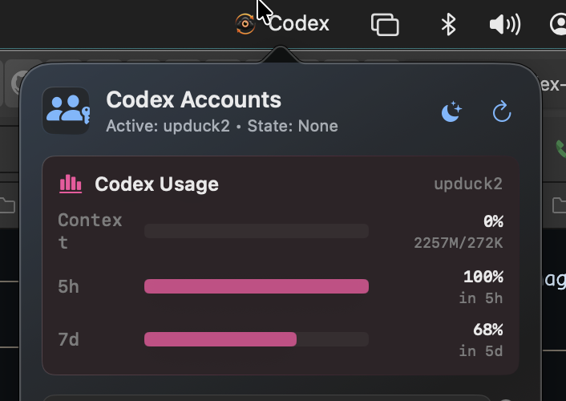

# Codex Account Manager: Clanked Edition

[This fork includes all the features of the original Codex Account Manager.](https://github.com/ngnthanhdev/codex-account-manager)

## What We Changed

Codex Account Manager: Clanked Edition keeps the local-first workflow and focuses its changes on clarity, safer switching, and a more useful macOS presentation.

### Streamlined UI

- Reworked the manager into compact profile cards with the important actions directly on each account.
- Reduced the effective window minimum so several profiles can fit comfortably on a MacBook screen.
- Moved the useful quick actions into a compact taskbar picker instead of relying on a redundant sidebar.
- Added friendly nicknames and profile renaming so account identity is easy to recognize at a glance.
- Added privacy mode, profile health badges, auth metadata, Token Vault, import, and local backup controls where they are needed.

### Theme-responsive presentation

- Added light and dark appearance controls.
- Made the manager, taskbar picker, status chips, profile cards, usage meters, and icon treatments respond to the selected theme.

### Safer account switching and recovery

- **Make Active Profile** now updates the live `~/.codex/auth.json` and restarts Codex so the selected account is actually live.
- Kept the separate Codex Desktop state switch available without confusing it with the active auth profile.
- Added explicit **Re-authenticate** and **Update Auth Token** recovery flows.
- Anchored each profile to its original signed-in identity so shared Team account IDs cannot mix labels or tokens.
- Preserve outgoing auth before switching and retain recovery copies when a token must be replaced.

### Usage and taskbar improvements

- Refresh the same per-profile quota snapshots for both the manager and taskbar picker.
- Shade inactive taskbar profiles from grey through red using 5-hour exhaustion; a fully exhausted 7-day limit also forces full red.
- Restore hover previews so hovering a taskbar entry shows that profile's exact remaining 5-hour and 7-day usage without changing the selected profile.
- Use one `AccountStore` selection and one quota-row implementation across the manager and taskbar, with the separate context-window meter removed from the taskbar.

### Clanked branding

- Renamed the app **Codex Account Manager: Clanked Edition**.
- Added a transparent eye-cloud icon with the original refresh arrows preserved.
- Keep profile and token data local; nothing is uploaded by the app itself.

## Screenshots

The compact menu-bar picker surfaces current usage and account switching without requiring the full manager window:



The app icon combines the Codex cloud, the supplied eye artwork, and the refresh arrows:


## Requirements

- macOS: OpenAI Codex Desktop App, Swift compiler (usually installed with Xcode Command Line Tools), and Python 3.
- Linux: Bash, Python 3 with PySide6, and an OpenAI Codex/ChatGPT desktop installation. `gtk-launch` and `xdg-open` are used for desktop integration.
- KDE on Wayland additionally uses PyGObject, GTK 3 and an AppIndicator library to show the quick switcher as a native menu anchored to the tray icon. If unavailable, the standard Qt tray is used.
- `zip` is optional on Linux and is only needed to export profile backups.
- Account identity parsing uses Python 3's standard library; `jq` is no longer required.

Check Swift:

```bash
swift --version
```

Install Xcode Command Line Tools if needed:

```bash
xcode-select --install
```

## Installation

Clone the repository:

```bash
git clone https://github.com/Plaer1/codex-account-manager.git
cd codex-account-manager
```

### macOS

Build and open the SwiftUI app:

```bash
./build.sh
open "build/Codex Account Manager Clanked Edition.app"
```

The macOS app includes the full SwiftUI manager and menu-bar picker.

### Linux beta

The Linux build is beta quality. Its Qt interface, browser sign-in, account switching, usage display, and KDE tray integration are available; desktop behavior and login still need wider real-world validation. Close Codex before switching accounts or desktop state.

Build and install the terminal manager and desktop-menu entry:

```bash
./build.sh
./build/linux/install-linux.sh
```

The command is `codex-account-manager`; the desktop menu entry opens the account manager and its system tray menu. `codex-account-manager interactive` opens the terminal menu. Start a new shell after installation so the PATH update takes effect.

The Linux window uses the desktop's Qt widget and color theme. Its account cards and tray show 5-hour and weekly usage when available. You can sign in through Codex in an isolated home, import an auth file, reauthenticate a profile, view account details and token status, set nicknames, and export backups. Reauthentication checks the fresh login with the usage service before replacing a saved profile and retains the new login files if verification fails.

Choose **Add account** to open browser sign-in. The manager chooses an available profile name after login; you can rename it later. Sign-in follows the desktop's default browser even when a `BROWSER` environment override points elsewhere. **Capture current** saves the account already signed in on the machine. Left-click the tray icon for the quick switcher and hover an account to preview its usage. On KDE Wayland, the switcher is a native tray menu anchored to the status icon.

On Linux, profiles are stored under `${XDG_DATA_HOME:-~/.local/share}/CodexAccountSwitcher`, Codex CLI auth is read from `~/.codex/auth.json`, and desktop state defaults to `${XDG_CONFIG_HOME:-~/.config}/Codex`. Override `CODEX_APP_SUPPORT` if your desktop app uses another state directory. Close Codex before making an account or desktop-state change; the Linux manager will refuse those operations while the app is running.

## Changed Workflows

### Make a Profile Active

**Make Active Profile** updates the live `~/.codex/auth.json` so the selected profile is actually the account Codex is using. The outgoing live auth is saved first, and switching is refused if the identity cannot be matched safely. macOS can restart Codex automatically; on Linux, close the desktop app first.

### Keep Desktop State Separate

The separate state action changes only the saved Codex Desktop state. Its default location is `~/Library/Application Support/Codex` on macOS and `${XDG_CONFIG_HOME:-~/.config}/Codex` on Linux. It does not silently change the active auth profile.

### Recover a Profile

**Re-authenticate** and **Update Auth Token** provide explicit recovery paths for a profile whose login needs to be renewed. Identity checks prevent a replacement login from being saved under the wrong profile, while nicknames and profile labels remain attached to the original signed-in user.

### Use the Taskbar Preview

The taskbar picker uses the same account selection and quota snapshots as the manager. Hover a profile to preview its exact remaining 5-hour and 7-day usage; hovering does not switch accounts. Inactive rows shade from grey to red by 5-hour exhaustion, with a fully exhausted weekly limit as the only override.

## Contributing

Bug fixes and improvements are welcome through pull requests.

- Report bugs with GitHub Issues.
- Send fixes through Pull Requests into `main`.
- Never include tokens, `auth.json`, cookies, profile folders, or real login data.
- See [CONTRIBUTING.md](CONTRIBUTING.md) for the full contribution guide.

To require owner review before changes are merged, enable branch protection for `main` on GitHub:

1. Go to **Settings > Branches**.
2. Add a rule for `main`.
3. Enable **Require a pull request before merging**.
4. Enable **Require approvals**.
5. Enable **Require review from Code Owners**.

## Local Data

Profiles are stored at:

```text
macOS: ~/Library/Application Support/CodexAccountSwitcher
Linux: ${XDG_DATA_HOME:-~/.local/share}/CodexAccountSwitcher
```

Each profile uses this structure:

```text
profiles/<name>/auth/auth.json
profiles/<name>/app-support/Codex
profiles/<name>/profile.env
profiles/<name>/identity.json
```

Do not commit or share this profile folder. It contains tokens, cookies, and Codex Desktop login state.

Profile backup zip files exported by the app contain the same sensitive data. Store them privately and delete old backups when you no longer need them.

## Security

Codex Account Manager is local-first:

- It sends saved access tokens to OpenAI's usage endpoint to request quota information; it does not send them to the app author or a custom server.
- It does not send profile data to a custom server.
- It does not store tokens in Git.
- It does not log token values to files or terminal output.

Treat the profile folder as sensitive data, just like a password manager export or a browser session.

## Build Output

After a successful build:

```text
build/Codex Account Manager Clanked Edition.app
build/linux/
```

The `build/` directory is ignored by Git.

## Release Pipeline

GitHub Actions builds the macOS app on every push or pull request to `main`.

To publish a release, push a version tag:

```bash
git tag v1.0.0
git push origin v1.0.0
```

The release workflow will:

- Validate `codex-account-switcher.sh`.
- Build `build/Codex Account Manager Clanked Edition.app`.
- Package the app as a zip file.
- Create a GitHub Release for tags that start with `v`.
- Upload the zip as a release asset.
- Build and upload the Linux desktop package as a CI artifact.

For a Linux beta artifact without a release, run the workflow manually with **Build only the Linux beta artifact** enabled and leave the release tag blank.

The release asset is currently unsigned and not notarized. macOS may show a Gatekeeper warning until code signing and notarization are added.

## License

MIT License. See [LICENSE](LICENSE).
